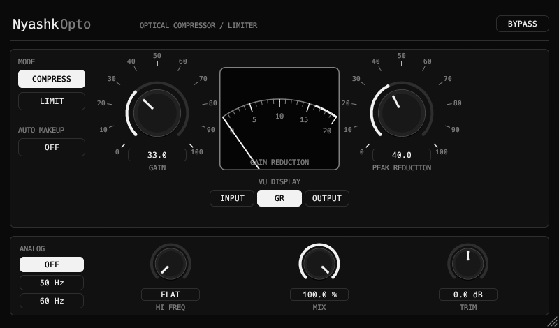

<div align="center">

# NyashkOpto

NyashkOpto is an LA-2A style optical compressor VST3 plugin.

[](https://github.com/xslimakx/NyashkOpto/actions/workflows/build.yml)
[](LICENSE)


[**Download**](https://github.com/xslimakx/NyashkOpto/releases/latest)

</div>

---

## 🎛 NyashkOpto — optical compressor

A model of an optical (opto-cell) compressor in the spirit of the LA-2A, in the same design as NyashkTune. Attack is program-dependent, and release is two-stage with memory.

<p align="center"></p>

| Control | What it does |
|---|---|
| **Peak Reduction** | Amount of compression |
| **Gain** | Output gain |
| **COMPRESS / LIMIT** | Compressor or limiter mode |
| **Hi Freq** (HF Follow) | High-frequency emphasis in the sidechain (tames sibilance) |
| **ANALOG** | OFF / 50 Hz / 60 Hz: soft saturation + mains hum, like real hardware |
| **Mix** | Parallel compression (dry/wet) |
| **Auto Makeup**, **Trim** | Automatic level compensation and output trim |
| **VU: INPUT / GR / OUTPUT** | What the VU meter shows: input, gain reduction or output |

---

## Installation

Download the archive for your OS from [Releases](https://github.com/xslimakx/NyashkOpto/releases/latest), unzip it and copy `NyashkOpto.vst3` into your VST3 folder:

| OS | Path |
|---|---|
| Linux | `~/.vst3/` or `/usr/lib/vst3/` |
| Windows | `C:\Program Files\Common Files\VST3\` |
| macOS | `~/Library/Audio/Plug-Ins/VST3/` |

## Building from source

Needs [Rust](https://rustup.rs/) (stable). Linux: `libasound2-dev libgl-dev libx11-xcb-dev libxcb1-dev libxcb-icccm4-dev libxcursor-dev libxkbcommon-dev libxcb-dri2-0-dev`.

```bash
git clone https://github.com/xslimakx/NyashkOpto.git
cd NyashkOpto
cargo xtask bundle -p nyashkopto --release   # -> target/bundled/NyashkOpto.vst3
cargo run --release -p nyashkopto --features standalone   # standalone test app
```

## License

[MIT](LICENSE). Note: compiled `.vst3` builds link GPLv3 `vst3-sys` bindings (via NIH-plug), so GPLv3 terms apply when you distribute compiled binaries. Crates in `vendor/` keep their own licenses.

Part of the Nyashk plugins family: [NyashkTune](https://github.com/xslimakx/NyashkTune) · [NyashkSynth](https://github.com/xslimakx/NyashkSynth)
